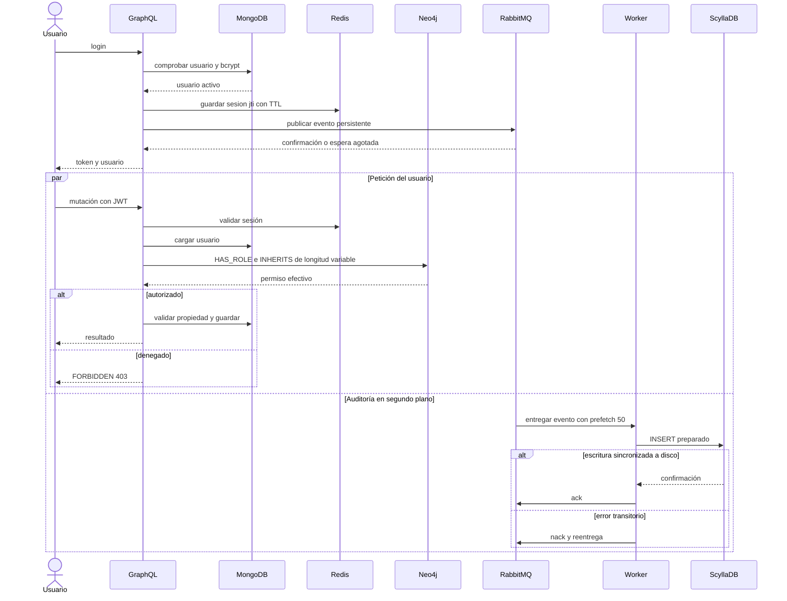

# Arquitectura y catálogo RBAC

El Gateway valida JWT y sesión en Redis, consulta roles en Neo4j y ejecuta las operaciones autorizadas en MongoDB. Las mutaciones de mascotas también validan propiedad. La autorización consulta el grafo; el rol incluido en el JWT no sustituye esa decisión.

## Secuencia integral

## Matriz de permisos

D es directo, H heredado y X denegado. La clave de cada permiso es path más method más operation.

| Ruta | Tipo | Operación | TUTOR | ADMIN | SUPER_ADMIN | Menú |
|---|---|---|---|---|---|---|
| /mi-perfil | QUERY | miPerfil | D | H | H | Mi cuenta / Mi perfil |
| /mascotas | QUERY | misMascotas | D | H | H | Mi cuenta / Mis mascotas |
| /actividad/:mascotaId | QUERY | resumenPaseos | D | H | H | Cuidado / Actividad |
| /salud/historial/:mascotaId | QUERY | historialMedico | D | H | H | Cuidado / Historial médico |
| /veterinaria/citas | QUERY | listarCitasPorPerro | D | H | H | Cuidado / Citas veterinarias |
| /admin/usuarios | QUERY | listarUsuarios | X | D | H | Administración / Usuarios |
| /mascotas/crear | MUTATION | crearMascota | D | H | H | Acción interna |
| /actividad/registrar | MUTATION | registrarActividad | D | H | H | Acción interna |
| /salud/vacunas/agregar | MUTATION | agregarVacuna | D | H | H | Acción interna |
| /veterinaria/citas/crear | MUTATION | crearCitaVeterinaria | D | H | H | Acción interna |
| /comunidad/publicar | MUTATION | crearPublicacion | D | H | H | Acción interna |
| /admin/razas/crear | MUTATION | crearRaza | X | D | H | Acción interna |
| /admin/veterinarias/crear | MUTATION | crearVeterinaria | X | D | H | Acción interna |

`miPerfil` corresponde al resolver obtenerUsuario; `misMascotas` a las consultas de mascotas; `crearMascota` al resolver crearPerro. MenuNode tiene título, icono, orden y padre. CAN_VIEW_MENU filtra opciones, HAS_CHILD organiza grupos y NAVIGATES_TO determina el destino. Las restricciones únicas cubren User.id, Role.name, MenuNode.id y la combinación Route(path, method, operation).

## Auditoría durable

La cola se declara durable y se publican mensajes persistentes con confirmaciones del broker. El productor selecciona y valida únicamente identificadores y campos de evento. El worker rechaza mensajes inválidos, utiliza sentencias preparadas y conserva el evento_id para que una reentrega escriba sobre la misma clave. ScyllaDB particiona por día UTC y tipo, y agrupa por timestamp y timeuuid descendentes. La demostración usa una réplica local y commitlog en modo batch.

Referencias de implementación: [confirmaciones de RabbitMQ](https://www.rabbitmq.com/docs/confirms) y [configuración de commitlog de ScyllaDB](https://docs.scylladb.com/manual/stable/reference/configuration-parameters.html).
