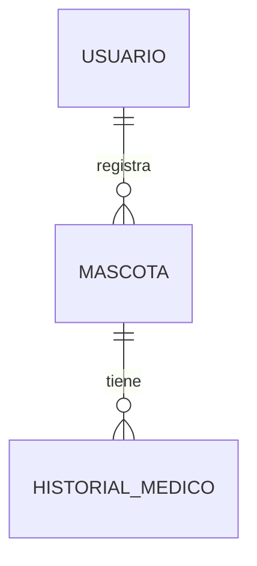
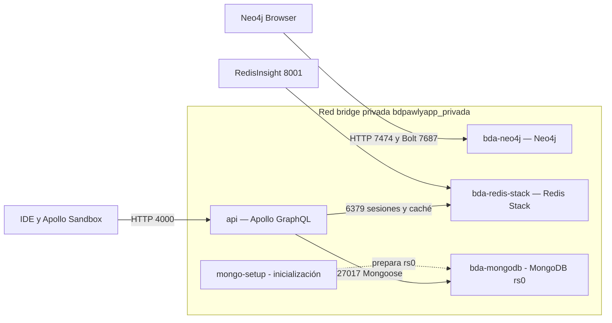
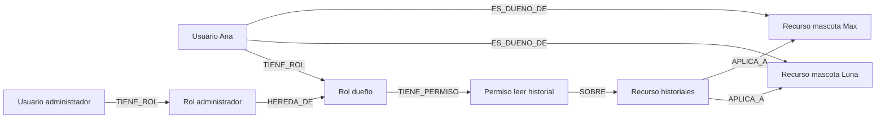

# Pawly: arquitectura Docker y bases de datos NoSQL

**Proyecto semestral — Bases de Datos Avanzadas**  
**Repositorio Beca1804/BDpawlyapp**

## 1. Descripción del proyecto

Pawly permite que un usuario registre varias mascotas y administre el historial
médico de cada una. En el ejemplo del proyecto, Ana es dueña de Luna y Max;
cada mascota conserva sus propios registros de consultas y tratamientos.

Esta entrega describe el backend actual, desarrollado con Node.js, Apollo Server
y GraphQL. MongoDB almacena usuarios, mascotas, catálogos, historiales médicos y los demás
registros del proyecto; Redis Stack administra caché y sesiones; Neo4j representa
el modelo conceptual de permisos.



Los modelos `Usuario` y `Perro` se guardan en MongoDB. `Perro.usuarioId` identifica
al dueño; `RegistroMedico.perroId` relaciona cada evento con su mascota. Los IDs
son ObjectId y el contrato GraphQL los expone como `ID`. Una misma cuenta puede
administrar Luna y Max sin mezclar sus expedientes. La API valida la sesión y la
propiedad antes de consultar documentos o devolver una copia desde Redis.

Se conserva la estructura original del repositorio: entidades de dominio,
modelos Mongoose y resolvers GraphQL. La cartilla y sus vacunas están embebidas en
el documento del perro. Los registros médicos, actividades y citas se guardan por
separado. El caché del expediente contiene registros médicos; no duplica la cartilla.
Los administradores se identifican por el rol `ADMIN` de la cuenta en MongoDB.

## 2. Docker y topología de contenedores



Los nombres `bda-mongodb`, `bda-redis-stack` y `bda-neo4j` son nombres de servicio
resueltos por el DNS interno de Docker. Compose añade el prefijo `bdpawlyapp` a los
nombres de los contenedores, evitando chocar con otros laboratorios.
Los servicios comparten una red bridge dedicada. Los puertos publicados se
vinculan a `127.0.0.1`, no a todas las interfaces. La red no se declara
`internal: true`: es una red dedicada, no una red sin salida a Internet.

| Servicio | Puerto dentro de Docker | Función | Acceso desde la computadora |
| --- | ---: | --- | --- |
| API | 4000 | Endpoint GraphQL | `API_PORT`, por defecto 4000 |
| MongoDB | 27017 | Protocolo de base documental | `MONGO_PORT`, por defecto 27017 |
| Redis Stack | 6379 | Caché y sesiones | `REDIS_PORT`, por defecto 6379 |
| RedisInsight | 8001 | Interfaz gráfica de Redis incluida en Stack | `REDISINSIGHT_PORT`, por defecto 8001 |
| Neo4j Browser | 7474 | Interfaz HTTP del grafo | `NEO4J_HTTP_PORT`, por defecto 7474 |
| Neo4j Bolt | 7687 | Protocolo para consultas y drivers | `NEO4J_BOLT_PORT`, por defecto 7687 |

En la computadora de desarrollo ya existían otros contenedores de clase.
El `.env` local usa **27019, 6381, 8003, 7476 y 7689**, respectivamente. Dentro de
Docker siguen usándose los puertos estándar. La API se publica en el puerto local
4002 y mantiene 4000 dentro del contenedor. No se versiona ese `.env`.

Los volúmenes `mongo_data`, `mongo_keyfile`, `redis_data` y `neo4j_data` conservan datos
al recrear contenedores. Redis usa AOF con `appendfsync always` para persistir
escrituras, incluidas las revocaciones. MongoDB y Redis tienen healthchecks y la
API espera a que estén disponibles. Neo4j tiene su propia comprobación de salud.

### Ejecución del entorno

El archivo `docker-compose.yml` declara los cinco servicios y permite levantarlos
juntos. Cuatro permanecen en ejecución; `mongo-setup` termina después de preparar
el replica set `rs0`. RedisInsight está incluido en Redis Stack, por lo que no requiere un sexto
contenedor. La API consulta MongoDB y Redis; Neo4j se consulta directamente
para demostrar el modelo de permisos.

En una instalación nueva, desde la raíz del repositorio:

```bash
cp .env.example .env
# Configurar contraseñas propias y JWT_SECRET en .env.
docker compose up -d --build --wait
docker compose ps
```

Las credenciales se guardan en `.env`, excluido de Git. Para detener los servicios
conservando los datos se utiliza `docker compose down`, sin la opción `-v`.
Los diagramas de este documento usan Mermaid y pueden visualizarse en GitHub
o en un lector Markdown compatible con Mermaid.

## 3. Modelo RBAC con Neo4j y Cypher

RBAC significa control de acceso basado en roles. Los permisos se asignan a roles
y los usuarios reciben esos roles. En Pawly se representan dos: dueño y administrador.
El dueño puede leer y editar historiales de sus mascotas; el administrador hereda
esos permisos y añade la gestión de catálogos.



Los nodos exigidos son `:Usuario`, `:Rol`, `:Permiso` y `:Recurso`.
Las relaciones centrales son `TIENE_ROL` y `TIENE_PERMISO`; se agregan `SOBRE`,
`HEREDA_DE`, `ES_DUENO_DE` y `APLICA_A` para representar el recurso y su propietario.

Ejemplo de restricción de unicidad:

```cypher
CREATE CONSTRAINT usuario_id IF NOT EXISTS
FOR (u:Usuario) REQUIRE u.id IS UNIQUE;
```

Las cuatro restricciones y los datos se encuentran en
`docker/neo4j/rbac.cypher`. `MERGE` y
`IF NOT EXISTS` permiten ejecutar el script nuevamente sin duplicar el grafo.

Consulta de permisos directos e indirectos:

```cypher
MATCH (u:Usuario {id:'demo-admin'})-[:TIENE_ROL]->(:Rol)
      -[:HEREDA_DE*0..]->(:Rol)-[:TIENE_PERMISO]->(p:Permiso)
      -[:SOBRE]->(r:Recurso)
RETURN DISTINCT u.nombre, p.nombre, r.nombre;
```

La longitud cero de `HEREDA_DE*0..` incluye permisos directos; una o más relaciones
incluyen los heredados. El dueño tiene lectura y edición de historial; el
administrador hereda esos permisos y añade gestión de catálogos.

### Nodos del modelo

| Etiqueta | Qué representa | Ejemplos |
| --- | --- | --- |
| `Usuario` | Persona que recibe un rol | Ana, administrador ficticio |
| `Rol` | Conjunto de responsabilidades | `dueno`, `administrador` |
| `Permiso` | Acción autorizable | `leer_historial`, `editar_historial`, `gestionar_catalogos` |
| `Recurso` | Elemento sobre el que se actúa | Historiales, catálogos, Luna y Max |

### Relaciones del modelo

| Relación | Origen → destino | Significado |
| --- | --- | --- |
| `TIENE_ROL` | Usuario → Rol | Asigna un rol al usuario |
| `TIENE_PERMISO` | Rol → Permiso | Concede una acción al rol |
| `HEREDA_DE` | Rol → Rol | Incluye los permisos del rol de destino |
| `SOBRE` | Permiso → Recurso | Indica el recurso al que se aplica la acción |
| `ES_DUENO_DE` | Usuario → Recurso mascota | Representa la propiedad de una mascota |
| `APLICA_A` | Recurso historiales → Recurso mascota | Vincula el historial con las mascotas del ejemplo |

### Restricciones de unicidad

Estas restricciones evitan repetir identificadores y nombres clave:

```cypher
CREATE CONSTRAINT usuario_id IF NOT EXISTS
FOR (u:Usuario) REQUIRE u.id IS UNIQUE;

CREATE CONSTRAINT rol_nombre IF NOT EXISTS
FOR (r:Rol) REQUIRE r.nombre IS UNIQUE;

CREATE CONSTRAINT permiso_nombre IF NOT EXISTS
FOR (p:Permiso) REQUIRE p.nombre IS UNIQUE;

CREATE CONSTRAINT recurso_id IF NOT EXISTS
FOR (r:Recurso) REQUIRE r.id IS UNIQUE;
```

### Cargar el ejemplo

El script del repositorio crea los nodos y relaciones con `MERGE`, de modo que
puede ejecutarse nuevamente sin duplicar los elementos del ejemplo:

```bash
docker compose exec -T bda-neo4j sh -c 'cypher-shell -u neo4j -p "$PAWLY_NEO4J_PASSWORD" -f /scripts/rbac.cypher'
```

Los usuarios `demo-ana` y `demo-admin` de Neo4j son datos conceptuales. No son
cuentas con contraseña y no se sincronizan automáticamente con MongoDB. La API
mantiene su autorización mediante propiedad de la mascota y configuración de
administradores; este grafo no decide los accesos de la API en tiempo de ejecución.

### Consultas conceptuales y resultados esperados

**Visualizar las relaciones del grafo:**

```cypher
MATCH camino=()-[]->()
RETURN camino;
```

**Mostrar las mascotas de Ana:**

```cypher
MATCH (u:Usuario {id:'demo-ana'})-[:ES_DUENO_DE]->(m:Recurso)
RETURN u.nombre AS usuario, collect(m.nombre) AS mascotas;
```

Resultado esperado: Ana con Luna y Max; el orden de las mascotas puede variar.

**Comprobar permiso de lectura y propiedad de Luna:**

```cypher
MATCH (u:Usuario {id:'demo-ana'})-[:TIENE_ROL]->(:Rol)
      -[:HEREDA_DE*0..]->(:Rol)
      -[:TIENE_PERMISO]->(:Permiso {nombre:'leer_historial'})
      -[:SOBRE]->(:Recurso {id:'historiales'})
      -[:APLICA_A]->(m:Recurso {id:'mascota-luna'})
WHERE EXISTS { MATCH (u)-[:ES_DUENO_DE]->(m) }
RETURN count(*) > 0 AS permitido;
```

Resultado esperado: `true`. Se comprueban tanto el permiso del rol como la
propiedad de la mascota. Tener un permiso genérico de lectura no implica ser
dueño de todas las mascotas.

**Comprobar que Ana no puede gestionar catálogos:**

```cypher
MATCH (:Usuario {id:'demo-ana'})-[:TIENE_ROL]->(:Rol)
      -[:HEREDA_DE*0..]->(:Rol)
      -[:TIENE_PERMISO]->(:Permiso {nombre:'gestionar_catalogos'})
RETURN count(*) > 0 AS permitido;
```

Resultado esperado: `false`. Este permiso pertenece al administrador.
Las consultas también se encuentran en `docker/neo4j/consultas.cypher`.

## 4. Index-Free Adjacency

Después de localizar el nodo inicial, Neo4j recorre
sus relaciones hacia los nodos vecinos mediante referencias de adyacencia.
No necesita volver a buscar cada vecino con un índice global como si realizara
joins sucesivos. Los índices y restricciones siguen siendo útiles para localizar
el usuario inicial; el término no significa que Neo4j no use índices.

En Pawly, una vez localizado el nodo de Ana, se sigue la ruta
`Usuario → Rol → Permiso → Recurso`. Para comprobar la propiedad también se sigue
`Usuario → ES_DUENO_DE → Mascota`. La estructura de grafo facilita expresar estas
conexiones y recorrer la herencia entre roles.

Esto no significa que todas las consultas tengan tiempo constante ni que el grafo
sea siempre más rápido que una base relacional: el trabajo depende de las
relaciones y los caminos recorridos. Los índices ayudan a encontrar el punto de
entrada y las relaciones permiten continuar desde él.

## 5. Justificación de paradigmas NoSQL

**MongoDB.** El historial médico se representa como documentos de eventos:
consulta, vacunación o tratamiento, con descripción, fecha y observaciones.
MongoDB es la fuente persistente de los nueve modelos principales del backend.
Los documentos se validan con Mongoose y se relacionan mediante ObjectId. Las
vacunas se guardan dentro de la cartilla de cada perro, porque se consultan como
parte de esa mascota. Los registros médicos se mantienen separados para consultar
su evolución y producir reportes por tipo de evento.

Las operaciones médicas usan sesiones y transacciones del replica set `rs0` para
confirmar o revertir las escrituras. La creación de los datos demo también agrupa
usuario, mascotas y registros en una transacción. Una prueba verifica el rollback
de un registro médico y una actividad escritos juntos. El replica set es de un
nodo: habilita transacciones, pero no proporciona alta disponibilidad.

Los resolvers comprueban referencias y propiedad antes de operar. Las operaciones
originales de otros módulos conservan su validación y escrituras atómicas por
documento. No se afirma que todas las operaciones del sistema formen una única
transacción. La invalidación de Redis ocurre después del commit de MongoDB;
los dos motores no comparten una transacción distribuida. Las escrituras directas
externas a la API deben respetar las referencias y gestionar la invalidación.

**Redis Stack.** Los historiales consultados repetidamente se almacenan con TTL
para reducir lecturas documentales. Las sesiones son datos temporales: se crean
al iniciar sesión y desaparecen por expiración o por `logout`. Redis permite
consultar y eliminar una sesión inmediatamente, algo que un JWT puramente
sin estado no permite. MongoDB sigue siendo la fuente persistente del historial.

**Neo4j.** Un usuario recibe un rol; el rol concede permisos sobre recursos.
Las relaciones del grafo permiten expresar tanto permisos directos como herencia
entre roles. El modelo evita duplicar cada permiso para cada usuario y hace
visible la ruta que justifica un acceso. En este parcial Neo4j se utiliza para
la demostración conceptual RBAC evaluada por la rúbrica; la autorización real de
la API conserva sus controles de propietario y administrador existentes.

### Comparación aplicada a Pawly

| Motor | Paradigma | Información asignada | Motivo de elección |
| --- | --- | --- | --- |
| MongoDB | Documental | Usuarios, mascotas y registros del proyecto | Documentos validados, referencias e índices; transacciones y agregación médica |
| Redis Stack | Clave-valor | Caché de historiales y sesiones | Facilita acceso por clave, expiración con TTL y eliminación inmediata |
| Neo4j | Grafos | Roles, permisos, recursos y propiedad conceptual | Expresa relaciones y permite recorrer permisos directos y heredados |

La selección responde a la función de cada dato. Los eventos médicos deben
persistir; las copias en caché pueden expirar; las sesiones necesitan revocación;
y el modelo de permisos se explica mediante conexiones. Los usuarios, las mascotas y los demás registros comparten ahora el mismo motor
documental y conservan el contrato GraphQL y las reglas de propiedad existentes.

### Ejemplo de funcionamiento

1. Ana inicia sesión y Redis guarda una sesión temporal asociada al token.
2. Ana consulta el historial de Luna. La API comprueba la sesión y la propiedad.
3. Si el historial no está cacheado, se lee de MongoDB y se guarda una copia
   temporal en Redis; una lectura posterior puede usar esa copia.
4. Si Ana modifica un registro, MongoDB guarda el cambio y se invalida la caché
   correspondiente para que la siguiente consulta obtenga la información actualizada.
5. Al cerrar sesión, se elimina su sesión de Redis y el mismo token deja de
   permitir consultas privadas.

El grafo Neo4j complementa la entrega mostrando conceptualmente por qué un rol
puede realizar una acción y cómo se relaciona el usuario con sus mascotas.

## 6. Implementación y evidencias del repositorio

Los nueve modelos principales son `Usuario`, `Raza`, `Perro`, `Veterinaria`,
`RegistroActividad`, `RegistroMedico`, `CitaVeterinaria`, `Publicacion` y
`Seguimiento`. Se mantienen sus nombres y relaciones. Las vacunas continúan como
subdocumentos de la cartilla. La API entrega fechas ISO e identificadores de texto
consistentes al leer documentos MongoDB o sus copias JSON en Redis.

El SDL define `login`, `logout`, `me`, `crearRegistroMedico`,
`actualizarRegistroMedico`, `eliminarRegistroMedico` y `resumenExpedientes`, junto
con las operaciones originales. `listarRegistrosMedicos` permite paginar por
mascota con `limit` y `offset`. Cada mutación médica invalida sus páginas de caché.
La clave de una página tiene la forma `expediente:mascota:<ObjectId>:v<version>:50:0`.
El TTL predeterminado de la caché es 60 segundos y el de la sesión es 3600 segundos.

El reporte `resumenExpedientes` utiliza `$match`, `$group`, `$project` y `$sort`
para contar registros por tipo entre las mascotas autorizadas. Los datos demo
contienen tres consultas y dos tratamientos distribuidos entre Luna y Max.
No se agregan automáticamente vacunas al reporte: pertenecen a la cartilla.

El contexto verifica firma, algoritmo, emisor, audiencia y expiración del JWT,
además de la sesión Redis, la cuenta activa y la vigencia de la contraseña.
Cada sesión usa un UUID `jti`; `logout` elimina `sesion:<jti>` con DEL, por lo que
el mismo token se rechaza inmediatamente con HTTP 401. Las contraseñas se guardan
con bcrypt y no se exponen en el contrato GraphQL.

Para comprobar la implementación en desarrollo:

```bash
docker compose exec api npm test
docker compose exec api npm run test:integration
```

Se verificaron seis pruebas unitarias y una integración que cubre las operaciones
originales, protección por propietario, caché, invalidación de altas, cambios y
bajas, reporte, rollback, expiración de sesión y revocación con HTTP 401.
En la prueba local del 20 de octubre de 2026, seis lecturas Redis registraron entre
0.034 y 0.051 ms, por debajo del umbral de 1.5 ms. La primera consulta MongoDB
registró 0.686 ms. Se mide la consulta o el GET, no el tiempo HTTP completo.
Durante la demostración se deben mostrar nuevas mediciones reales, pues el tiempo
varía con la computadora y su carga.

El código y los comandos de la entrega corresponden a
`https://github.com/Beca1804/BDpawlyapp`, en la rama
`feature/segundo-parcial-redis-expedientes`. El guion de demostración se encuentra
en `docs/DEMOSTRACION_EN_VIVO.md`.
